

  <a href="https://sohambasanwar.vercel.app">
    
  </a>

  
  
  

I'm a Computer Science student at the **University of Illinois Chicago** (graduating Fall 2027, major GPA 3.9) and I'm looking for **Summer 2027 internships** in AI / ML engineering, full-stack with AI, front end or back end.

I like building things people can actually use: AI that adapts to how someone feels or works, apps with real polish, and the low-level systems underneath. I'm especially curious about where AI meets **health, psychology and the human heart**.

## Right now

  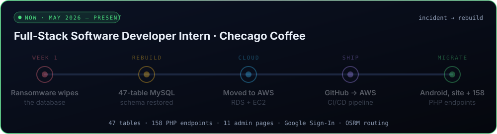

In my first week at **Checago Coffee**, a ransomware attack wiped the company database. I rebuilt it, then the infrastructure around it:

- Recovered and modernized a **47-table MySQL database** and moved it to **AWS RDS and EC2**
- Set up **GitHub → AWS CI/CD** and new roles and credentials for the new security model
- Created or refactored **158 PHP API endpoints** and migrated the Android app and website onto them
- Shipped Android features (a gamification tier system, Google Sign-In, OSRM map routing) and **11 new pages** for the React admin platform

## Featured work

  <a href="https://github.com/SohamBasanwar/sohamalloc">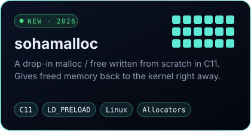</a>
  <a href="https://github.com/SohamBasanwar/PersistAI">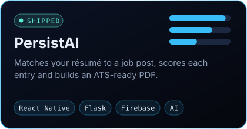</a>

  <a href="https://github.com/SohamBasanwar/Checkers"></a>
  <a href="https://github.com/SohamBasanwar/Weather-App"></a>

  <a href="https://github.com/SohamBasanwar/Saya">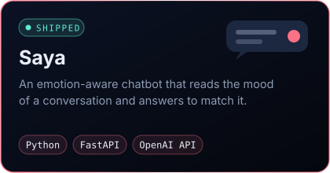</a>
  <a href="https://sohambasanwar.vercel.app">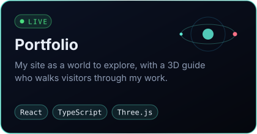</a>

<b>More about each project</b>

 

| Project | What it is | Links |
|---|---|---|
| **sohamalloc** | A general-purpose `malloc`/`free`/`new`/`delete` in C11 that you load with `LD_PRELOAD`. It returns freed memory to the kernel in batched `process_madvise` calls, keeps its bookkeeping out of line behind guard pages, and encodes free-list links. | [repo](https://github.com/SohamBasanwar/sohamalloc) |
| **PersistAI** | My first complete project. It matches résumé entries to a job description with a custom scoring pipeline and generates an ATS-friendly PDF. React Native + Expo front end, Flask back end, Firebase. | [repo](https://github.com/SohamBasanwar/PersistAI) · [demo](https://youtu.be/LUslo5eH1Ac) |
| **Checkers Online** | Networked two-player checkers: a server with its own dashboard, JavaFX clients and a shared protocol module. Java 17, Maven, 67 tests. | [repo](https://github.com/SohamBasanwar/Checkers) |
| **Simple Weather** | A JavaFX desktop app on the National Weather Service API with 16 animated weather conditions, particles, alerts, favorites and a mascot. 70 tests. Built with Ronit Mishra for CS 342. | [repo](https://github.com/SohamBasanwar/Weather-App) |
| **Saya** | An emotion-aware chatbot on FastAPI and the OpenAI API that tags each reply with an emotion and changes its tone for who it's talking to. | [repo](https://github.com/SohamBasanwar/Saya) |
| **Portfolio** | My site, built in React, TypeScript and Three.js, with a 3D guide who walks you through my work. | [live](https://sohambasanwar.vercel.app) · [v2 repo](https://github.com/SohamBasanwar/portfolio-v2) |
| **Transportation Data Science** | Columbia University TDSP: Python workflows for cleaning, time-series and geospatial analysis of crash data, ending in safety recommendations. | [repo](https://github.com/SohamBasanwar/TDSP) · [notebook](https://colab.research.google.com/drive/1Uj7I6AlhjTPTTqzSD_AMjYUuQm-j3G1V?usp=sharing) |
| **Python Fundamentals App** | A CS 111 hackathon app that teaches Python with animated modules, quizzes and progress reports. | [demo](https://youtu.be/-gCidfXCt_E) |

### In the lab

  <a href="https://sohambasanwar.vercel.app">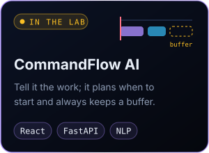</a>
  <a href="https://sohambasanwar.vercel.app">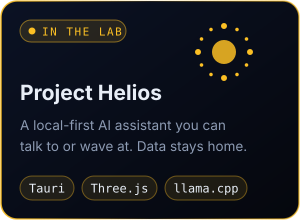</a>
  <a href="https://sohambasanwar.vercel.app">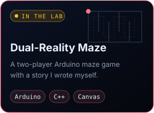</a>

## Recognition

  

- **Columbia University Transportation Data Science Project** certificate
- **CodePath Technical Interview Prep (TIP 102)**, intermediate level
- **Checago Coffee** internship completion certificate

## Toolbox

  
  
  
  
  
  
  
  
  
  
  
  

  
  
  
  
  
  
  
  

  
  
  
  
  
  
  
  
  

**Interested in:** NLP · computer vision · applied ML · emotion-aware AI · AI for health

## Activity

  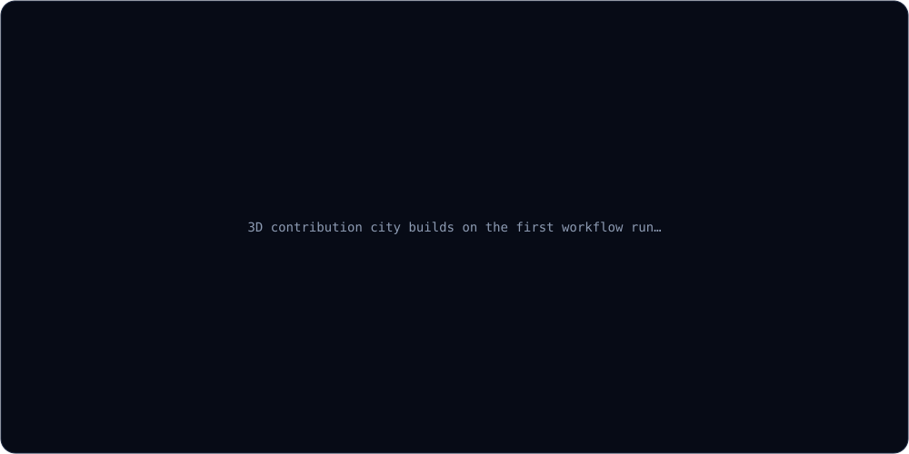

  
  

  <picture>
    <source media="(prefers-color-scheme: dark)" srcset="generated/snake-dark.svg" />
    <source media="(prefers-color-scheme: light)" srcset="generated/snake.svg" />
    
  </picture>

Rebuilt every day by a GitHub Action in this repo.

  
  
  
  

> I prefer building systems that are practical, polished, and technically real — not just ideas on paper.
